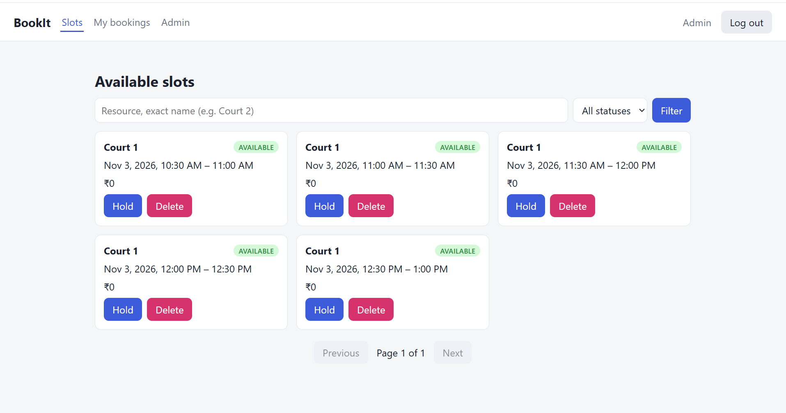
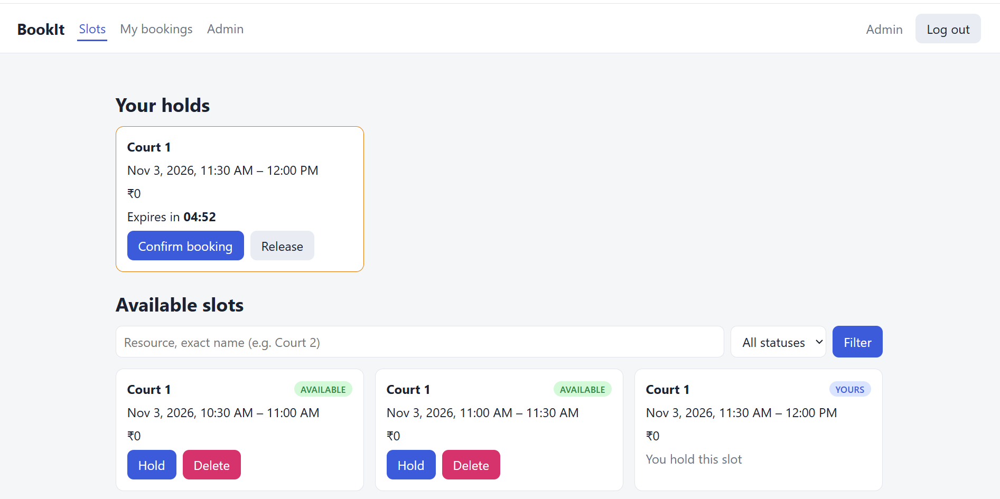
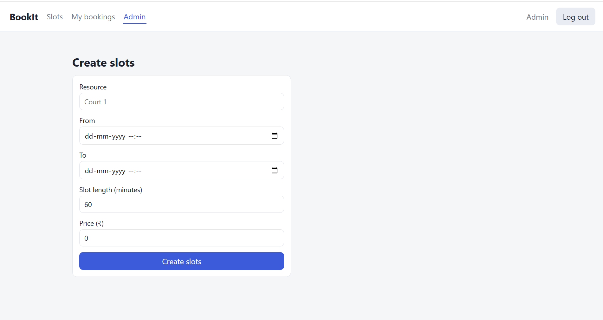
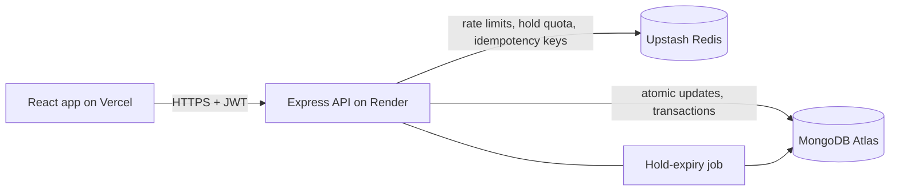

# BookIt: slot booking that can't double-book

[](https://github.com/raj-balram/BookIT/actions)

**Live demo:** https://bookit-frontend-pi.vercel.app  
**API health:** https://bookit-api-lhnz.onrender.com/health  
*Hosted on free tiers: the first request after a quiet period can take a while.*

| Browse and hold slots | Hold countdown | Admin: create slots |
|---|---|---|
|  |  |  |

Users browse time slots, hold one for 5 minutes, then confirm it. The system guarantees at most one booking per slot, even under heavy concurrent requests.

## The problem this solves

A naive "check the slot is free, then book it" has a race condition: when many requests arrive together, they all pass the check before any of them writes. The repo keeps that broken version (`/api/bookings/naive`, disabled in production) next to the fix, and a test proves the difference.

## Results

| Test | Load | Result |
|---|---|---|
| Race test (Jest) | 50 simultaneous bookings, one slot | naive: 48 to 50 of 50 double-booked (varies per run); fixed: exactly 1 of 50 |
| `flow` (k6) | 50 users, 1,500 hold, then confirm | ~158 bookings/s, p95 confirm 316 ms, p95 hold 213 ms, 0% errors |
| `browse` (k6) | ramp to 50 users, paginated listing | ~229 req/s, p95 125 ms, 0% errors |

After the `flow` run, database checks confirmed 1,500 confirmed bookings = 1,500 booked slots = 1,500 payments and no slot with two bookings.

*Measured on one laptop running the API, MongoDB, Redis and k6 together, with rate limits switched off in load mode.*

## How it works



- **Claiming a slot is one atomic operation:** `findOneAndUpdate` with the status in the filter, so only one concurrent request can match.
- **Safety net:** a unique partial index allows at most one confirmed booking per slot.
- **Confirm uses a MongoDB transaction** (slot, booking, payment record). A test forces a failure mid-way and checks that nothing is committed.
- **Expired holds are claimable directly by the query.** The background job only tidies up, so correctness never depends on a timer.
- **Idempotency keys (Redis):** a retried or double-clicked confirm replays the original response instead of running twice.
- **Rate limiting and a 3-hold cap per user** run as Lua scripts in Redis, so the check and the update can't race.
- **Deactivated accounts stay deactivated:** login never reactivates one (a bug I found in an internship project, now covered by a regression test).

## API

| Method | Path | Notes |
|---|---|---|
| POST | `/api/auth/register`, `/api/auth/login` | JWT; role is never taken from the request |
| GET | `/api/auth/me` | current user |
| GET | `/api/slots` | filters: `resource`, `status`, `from`, `to`; paginated |
| GET | `/api/slots/holds/me` | my active holds |
| POST / DELETE | `/api/slots/:id/hold` | hold for 5 min / release |
| POST | `/api/bookings` | confirm a hold; requires `Idempotency-Key` header |
| GET | `/api/bookings/me` | my bookings |
| POST | `/api/admin/slots`, `/api/admin/slots/bulk` | admin only |
| DELETE | `/api/admin/slots/:id` | admin only, available slots only |
| GET | `/health` | Mongo and Redis status |

## Run locally

```bash
docker compose up -d            # MongoDB replica set (port 27018) + Redis (port 6380)
cd Backend
cp .env.example .env            # Windows: copy .env.example .env, then set JWT_SECRET
npm install
npm run seed:admin
npm run dev
# second terminal
cd Frontend && npm install && npm run dev
```

Locally the connection string uses `directConnection=true`, because the replica set advertises its address as seen from inside the container.

## Tests and load tests

```bash
cd Backend
npm test                        # 53 tests; starts an in-memory MongoDB replica set; needs Redis running
npm run load:seed && npm run start:load                      # terminal 1: separate "bookit_load" database
k6 run -e SCENARIO=contention load/k6.js                     # terminal 2 (also: flow, browse)
npm run load:verify             # checks the database for duplicates and mismatches
```

## Deployment

Atlas (database), Upstash (Redis), Render (API, Docker, root directory `Backend`), Vercel (frontend, root directory `Frontend`). A production `docker-compose.prod.yml` runs the whole stack locally. Required settings are listed in `Backend/.env.example`.

## Known limitations

- Payments are simulated (a payment record is written, no gateway).
- No booking cancellation or refund flow yet.
- The rate limiter is a fixed window, so bursts at window edges can briefly exceed the limit.
- The JWT is kept in localStorage (simple, but exposed to XSS); an httpOnly cookie would need CSRF protection.
- If the server crashes after the database commit but before the idempotency result is stored, a retry within 30 seconds can return a 409 even though the booking exists.